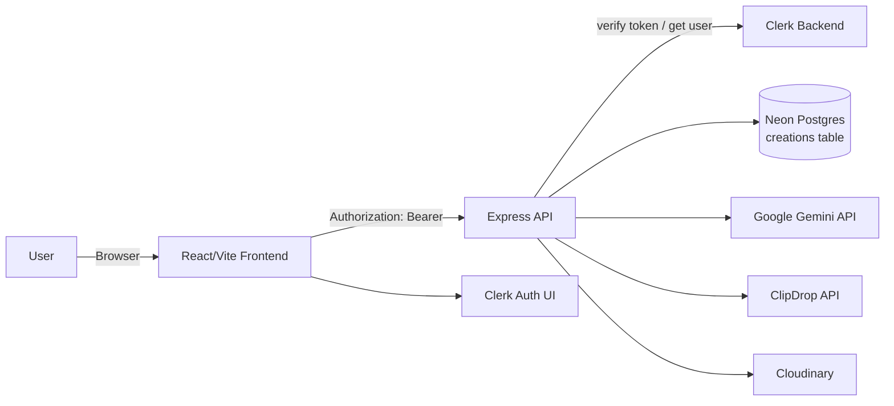

# SwiftSuggest ("Quick AI")

SwiftSuggest is a full‑stack web app that bundles multiple AI-powered tools into one place: writing articles, generating blog titles, generating images, removing image backgrounds/objects, and reviewing resumes.

It’s split into two apps:

- **client/** — React + Vite frontend (UI)
- **server/** — Express backend (API) that talks to external AI/services and stores results

---

## For non‑technical readers (what this app does)

Think of SwiftSuggest as a “toolbox website” for creators:

- **Write Article**: Type a topic → get a structured article back.
- **Blog Title Generator**: Enter a keyword/category → get multiple title ideas.
- **AI Image Generator**: Describe an image + choose a style → generate an image.
- **Background Removal**: Upload an image → get the same image with background removed.
- **Object Removal**: Upload an image + specify one object name → get the image with that object removed.
- **Resume Review**: Upload a PDF resume → get feedback/improvements.
- **Dashboard**: See your recent creations.
- **Community**: View public creations (currently: public images) and like/unlike them.

**Login is required** (handled via Clerk). Some features are gated behind a **premium plan**.

---

## How it works (simple explanation)

1. You sign in on the website.
2. The frontend sends your request (prompt/file) to the backend.
3. The backend verifies you’re logged in (and checks your plan).
4. The backend calls external services to generate results:
   - Text is generated by **Google Gemini**.
   - Images are generated by **ClipDrop** (text-to-image) and/or processed by **Cloudinary** transformations.
5. The backend stores each “creation” in a database.
6. The frontend shows your results in the dashboard. If you chose “Make this image public”, it also appears in the community feed.

---

## Tech stack (developer view)

### Frontend (client)

- **React 19** + **Vite 7**
- **react-router-dom** for routing
- **Tailwind CSS v4** (via `@tailwindcss/vite`)
- **Clerk** (`@clerk/clerk-react`) for auth + pricing table
- **axios** for HTTP requests
- **react-hot-toast** for notifications
- **react-markdown** for rendering AI text output
- **lucide-react** for icons

### Backend (server)

- **Node.js (ESM)** + **Express 5**
- **Clerk** (`@clerk/express`) for auth verification
- **Neon serverless** (`@neondatabase/serverless`) for Postgres access
- **Cloudinary** for media storage + transformations
- **multer** for file uploads (in-memory)
- **pdf-parse** for extracting text from uploaded resumes
- **axios** for calling external APIs (Gemini, ClipDrop)
- **dotenv** for environment variables

---

## High-level architecture



---

## Product features & plan limits

The backend enforces plan checks in `server/middlewares/auth.js`.

- **Free plan**
  - Article generation: allowed up to **10 uses** (tracked in Clerk `privateMetadata.free_usage`)
  - Blog title generation: allowed up to **10 uses**
- **Premium plan required**
  - Image generation
  - Background removal
  - Object removal
  - Resume review

The UI contains some “testing” logic for premium detection (see “Notes / known gaps”).

---

## Routes (frontend pages)

Defined in `client/src/App.jsx`:

- `/` → Landing page (`Home`)
- `/app` → App layout with sidebar (`Layout`)
  - `/app` (index) → `Dashboard`
  - `/app/dashboard` → `Dashboard`
  - `/app/write-article` → `WriteArticle`
  - `/app/blog-title` → `BlogTitle`
  - `/app/generate-images` → `GenerateImages`
  - `/app/remove-background` → `RemoveBackground`
  - `/app/remove-object` → `RemoveObject`
  - `/app/review-resume` → `ReviewResume`
  - `/app/community` → `Community`

---

## API (backend endpoints)

The Express server mounts routers in `server/server.js`:

- `GET /` → health check (“Server is running”)
- `POST /api/ai/*` → AI features
- `GET/POST /api/user/*` → user/creation features

All `GET/POST /api/*` endpoints require authentication via the custom `auth` middleware (which depends on Clerk).

### Auth header

Frontend sends:

- `Authorization: Bearer <token>`

Token is fetched using Clerk (`getToken()`) in the React pages.

### AI endpoints (`/api/ai`)

From `server/routes/airoutes.js`:

- `POST /api/ai/generate-article`
  - Body: `{ "prompt": "..." }`
  - Uses: Gemini (text)
  - Saves: a new row in `creations` (`type='article'`)

- `POST /api/ai/generate-blog-title`
  - Body: `{ "prompt": "..." }`
  - Uses: Gemini (text)
  - Returns: `titles` array
  - Saves: `type='blog-title'` (stores titles as JSON string in DB)

- `POST /api/ai/generate-image` *(premium)*
  - Body: `{ "prompt": "...", "publish": true|false }`
  - Uses: ClipDrop (text-to-image) → uploads result to Cloudinary
  - Saves: `type='image'`, `content=<image url>`, `publish=<publish>`

- `POST /api/ai/remove-image-background` *(premium)*
  - Content-Type: `multipart/form-data`
  - File field: `image`
  - Uses: Cloudinary `background_removal` transformation
  - Saves: `type='image'`

- `POST /api/ai/remove-image-object` *(premium)*
  - Content-Type: `multipart/form-data`
  - File field: `image`
  - Body field: `object` (expects a single-word object name in the UI)
  - Uses: Cloudinary `gen_remove:<object>` transformation
  - Saves: `type='image'`

- `POST /api/ai/resume-review` *(premium)*
  - Content-Type: `multipart/form-data`
  - File field: `resume` (PDF)
  - Uses: `pdf-parse` → Gemini
  - Saves: `type='resume-review'`

### User endpoints (`/api/user`)

From `server/routes/userRoutes.js`:

- `GET /api/user/get-user-creations`
  - Returns: all creations for the logged-in user

- `GET /api/user/get-published-creations`
  - Returns: all creations where `publish = true` (used by Community page)

- `POST /api/user/toggle-like-creation`
  - Body: `{ "id": <creationId> }`
  - Toggles the current user’s id inside the `likes` array

---

## Database (Neon Postgres)

The server uses Neon via `server/configs/db.js` and expects a Postgres database with a `creations` table.

**Minimum fields used by the code** (inferred from queries and inserts):

- `id` (used as identifier)
- `user_id` (Clerk user id)
- `prompt` (what user asked)
- `type` (e.g. `article`, `blog-title`, `image`, `resume-review`)
- `content` (text or image URL)
- `publish` (boolean; used for Community feed)
- `likes` (text array; used for like/unlike)
- `created_at` (used for ordering)

If you don’t already have a schema, here is a starting point:

```sql
CREATE TABLE IF NOT EXISTS creations (
  id          SERIAL PRIMARY KEY,
  user_id     TEXT NOT NULL,
  prompt      TEXT NOT NULL,
  type        TEXT NOT NULL,
  content     TEXT NOT NULL,
  publish     BOOLEAN NOT NULL DEFAULT FALSE,
  likes       TEXT[] NOT NULL DEFAULT '{}',
  created_at  TIMESTAMPTZ NOT NULL DEFAULT NOW()
);
```

---

## Environment variables

No `.env` files are committed in this repo. You must create them locally.

### client/.env

Required:

- `VITE_CLERK_PUBLISHABLE_KEY` — Clerk publishable key used by the frontend

Optional:

- `VITE_BASE_URL` — backend base URL (defaults to `http://localhost:3000`)

### server/.env

Required:

- `DATABASE_URL` — Neon Postgres connection string
- `CLOUDINARY_CLOUD_NAME`
- `CLOUDINARY_API_KEY`
- `CLOUDINARY_API_SECRET`
- `GEMINI_API_KEY` — used for article/blog/resume text generation
- `CLERK_SECRET_KEY` — required for `@clerk/express`

Optional / feature-specific:

- `CLIPDROP_API_KEY` — required for image generation
- `GEMINI_MODEL` — optional Gemini model name (defaults to `gemini-3.5-flash-lite`)
- `PORT` — Express port (defaults to `3000`)

---

## Running locally

### Prerequisites

- Node.js (recommended: **18+**)
- Accounts/keys for:
  - Clerk
  - Neon Postgres
  - Cloudinary
  - Google Gemini API
  - ClipDrop (only if you use image generation)

### 1) Start the backend

```bash
cd server
npm install
npm run server
```

Notes:

- The dev script is named `server` (nodemon). `npm start` runs plain Node.

### 2) Start the frontend

```bash
cd client
npm install
npm run dev
```

Defaults:

- Vite dev server: `http://localhost:5173`
- API server: `http://localhost:3000`

---

## Deployment

- **client/** includes a `vercel.json` configured as a static SPA build (rewrites all routes to `index.html`).
- **server/** also contains a `vercel.json`, but the backend is a long-running Express server (`app.listen(...)`). If you want to deploy the backend on Vercel, you typically need to adapt it to Vercel Functions or deploy it to a Node server host (Render/Railway/Fly/etc).

---

## Code tour (what’s where)

### client/

- `index.html` — HTML entry
- `vite.config.js` — Vite config (ports, build output)
- `eslint.config.js` — ESLint rules
- `src/main.jsx` — app bootstrap + `ClerkProvider` + router
- `src/App.jsx` — React Router route map
- `src/index.css` — Tailwind import + global styles + theme primary color
- `src/assets/` — images + data arrays
  - `assets.js` — tool cards data + dummy fallback data
- `src/components/` — reusable UI blocks
  - `Navbar`, `Hero`, `AiTools`, `Plan` (Clerk pricing), `SideBar`, `Footer`, etc.
- `src/pages/` — route-level screens
  - `WriteArticle`, `BlogTitle`, `GenerateImages`, `RemoveBackground`, `RemoveObject`, `ReviewResume`, `Dashboard`, `Community`
  - `WriteArticleNew.jsx` / `WriteArticleTest.jsx` are currently empty placeholders

### server/

- `server.js` — Express app, middleware setup, route mounting
- `configs/`
  - `db.js` — Neon DB client (requires `DATABASE_URL`)
  - `cloudinary.js` — Cloudinary configuration
  - `multer.js` — upload config (memory storage, 5MB limit)
- `middlewares/auth.js` — Clerk auth + plan check + free usage counter
- `routes/`
  - `airoutes.js` — AI endpoints
  - `userRoutes.js` — user/creation endpoints
  - `debugRoutes.js` — empty
- `controllers/`
  - `aiController.js` — core AI + image processing logic
  - `userController.js` — dashboard + community + likes
  - `debugController.js` — empty
- `test-*.js` — standalone scripts to test external services
  - `test-gemini.js`, `test-clipdrop.js`, `test-server.js`

---

## Notes / known gaps

These are not blockers to understand the project, but they matter if you plan to extend it:

- The landing-page tool cards in `client/src/assets/assets.js` use `/ai/...` paths, while the actual app routes are under `/app/...`.
- `client/src/components/SideBar.jsx` currently returns `true` for premium status in “Method 4” (testing fallback). The backend still enforces premium rules.
- `server/routes/debugRoutes.js` and `server/controllers/debugController.js` exist but are empty and not mounted.

---

## Contributing / extending

A simple way to add a new AI tool:

1. Add a new page in `client/src/pages/` and route it in `client/src/App.jsx`.
2. Add a new backend endpoint under `server/routes/airoutes.js` and implement it in `server/controllers/aiController.js`.
3. Store output in the `creations` table so it appears in the dashboard.

---

## Support

If the UI shows “Authentication required” or premium errors:

- Confirm Clerk keys are set in both frontend and backend env
- Confirm you’re sending `Authorization: Bearer <token>`
- Confirm your Clerk user has the expected plan/permissions


this is my project overview named IngrediantsIq now act as my mentor and I want you to prepare me for the interview, teach me how to answer the most common question in interview and also any question which should be asked in my interview I must be able to answer it correctly.